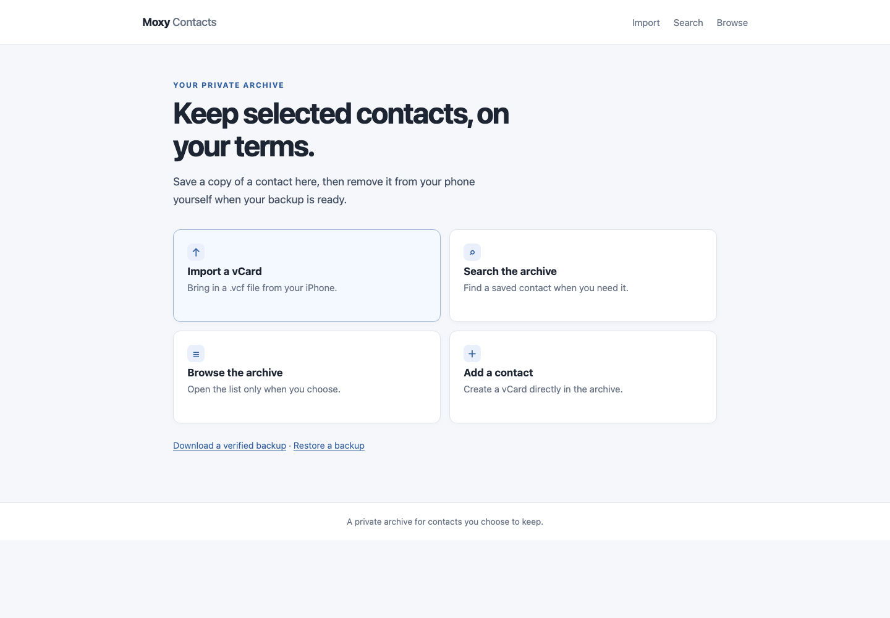
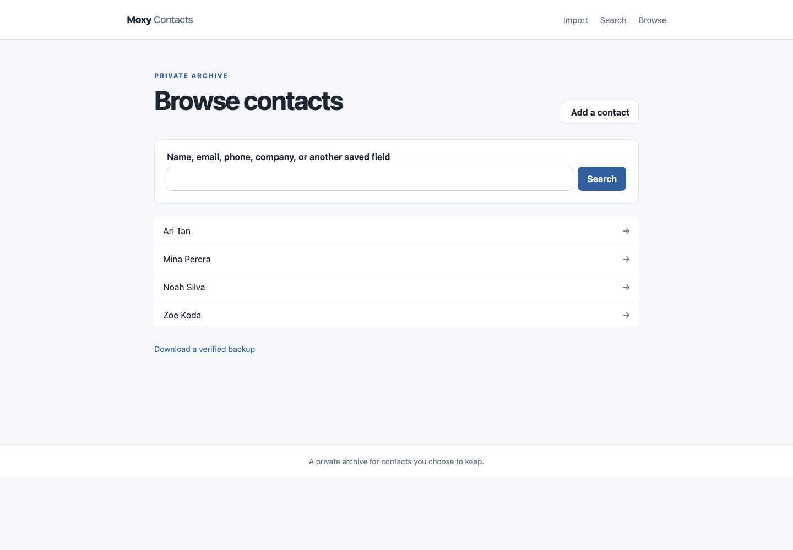

# Moxy Contacts

[](https://github.com/Thavarshan/moxy-contacts/actions/workflows/ci.yml)
[](LICENSE)

Moxy is a private archive for selected contacts from your iPhone. Import a `.vcf`, review the result, download a verified backup, and export a contact back to `.vcf` when you need it. Moxy never changes your phone or iCloud.

## Preview

These screenshots use synthetic contact records.

<p align="center">
  
  
</p>

## Run it locally

You need Python 3.13+, [uv](https://docs.astral.sh/uv/), Node.js, npm, and Git.

```sh
uv sync --locked --all-groups
npm ci
cp .dev.vars.example .dev.vars
# Change SESSION_SECRET in .dev.vars to a random local-only value.
npm run build
npx wrangler d1 migrations apply DB --local
uv run pywrangler dev
```

Open `http://localhost:8787`. Local development uses a local D1 database. The migration command creates its tables from `migrations/0001_initial.sql`. The `.dev.vars` file is ignored by Git.

## Import and restore iPhone contacts

1. On iPhone, select the contacts you want to archive and export them as a `.vcf` file.
2. Sign in to the app, choose **Import**, and upload that file.
3. Review the import report. Malformed entries are listed; valid entries are kept. Identical cards are skipped by default. Similar contacts are kept separately and called out for review.
4. Download the verified ZIP backup and save it somewhere you control before removing anything from your phone.
5. To restore a contact to your phone later, find it in the archive and choose **Export .vcf**. Import that file into Contacts on your iPhone.

A ZIP backup contains the exact imported vCards, the current edited vCards, and SHA-256 checksums. To recover an archive, use **Restore backup** and select that ZIP. The app checks every file and checksum before restoring; exact duplicates are skipped unless you choose to keep extra copies.

## What is preserved

Moxy uses the Python `vobject` library and handles common vCard 3.0 records, repeated phones/emails/addresses, custom Apple labels, Unicode, folded lines, escaped text, and base64 photos. It keeps each uploaded card's exact original bytes and unknown properties. The detail page shows parsed properties without hiding unrecognized names.

The editor changes the current export copy only. It is a complete vCard text editor: lines you leave in place, including Apple-specific lines, export with the contact. If you remove a line, it is absent from the edited export but remains in the saved original and backup. Apple Contacts formats vary; this project has representative synthetic iPhone-style coverage, not a claim of complete Apple compatibility. Each vCard is limited to 1.9 MB.

## Files to know

- `src/contacts/app.py` — Flask pages, forms, and web security.
- `src/contacts/archive.py` — import, duplicate review, editing, export, and backup rules.
- `src/contacts/vcards.py` — vCard parsing and safe display values.
- `src/contacts/storage.py` — local SQLite-compatible operations and the Cloudflare D1 adapter.
- `src/contacts/templates/` — the HTML pages.
- `assets/css/style.css` — editable stylesheet; `public/` contains the built static copy.
- `migrations/` — D1 table definitions.
- `tests/fixtures/` and `tests/` — synthetic examples and checks; never add real contacts here.
- `wrangler.jsonc` — Cloudflare Worker, static files, and D1 configuration.

## Storage, backup, and deletion

Cloudflare D1 stores contact summaries and private vCard documents in separate tables. Photos remain embedded inside the private vCard; nothing is placed in public assets. D1 is persistent across deployments and is on Cloudflare's free tier within its published quotas. D1 Time Travel can retain deleted database states for up to seven days. Deleting a record removes it from the active archive, but it does not erase ZIP backups you downloaded or instantly remove historical database states. Keep your own current backup and delete old copies when you no longer need them.

The app has no phone/iCloud sync, automatic exports, or background jobs. Free D1 currently includes up to 500 MB per database, with account-level storage and daily read/write quotas. Cloudflare Workers Free has a daily request limit. Check the linked current limits before storing a large archive: [D1 limits](https://developers.cloudflare.com/d1/platform/limits/), [D1 pricing](https://developers.cloudflare.com/d1/platform/pricing/), [Workers limits](https://developers.cloudflare.com/workers/platform/limits/). No paid plan or add-on is enabled by this project.

## Sign-in, checks, and deployment

Cloudflare Access must protect the Worker before the app is deployed. Its allow policy should include only the owner's exact sign-in email, and should cover the `workers.dev` hostname. Preview URLs are disabled. The application does not accept identity headers or a source-code flag as proof of sign-in; Cloudflare Access blocks unauthenticated requests before Flask runs.

Before first-time Access setup, the production app returns a generic `503` until `SESSION_SECRET` is deployed. Setting that signing secret does not authenticate anyone. Only deploy the secret after Cloudflare Access is enabled and verified.

GitHub Actions runs formatting, lint, types, tests (including a local Worker + D1 round trip), frontend asset checks, and a package build. Production deployment is a separate manual workflow run from `main`; it first passes the same commit through checks, verifies the actual Access application and exact-email policy through Cloudflare's API, and checks that unauthenticated requests are blocked. Only then does it apply the D1 migration and deploy. A post-deployment check repeats the unauthenticated request test.

For CI deployment, add repository secret `CLOUDFLARE_API_TOKEN` with Workers Scripts edit, D1 edit, and Access Apps and Policies read permissions for this Cloudflare account. Set repository variable `CLOUDFLARE_ACCOUNT_ID` to this account's ID, and secret `SESSION_SECRET` to a long random value. Set `ACCESS_OWNER_EMAIL` to the exact email allowed by Access and `PRODUCTION_WORKER_URL` to the Worker origin. The deploy workflow only runs when you choose **deploy** for a dispatch from `main`; it never deploys on a normal push.

The public repository's `main` branch ruleset requires pull requests, resolved review conversations, and the `checks` status; it also blocks force pushes and branch deletion. Production deployment only runs through a manual workflow dispatch from `main` after checks and the Access policy preflight. Pushes run CI and never deploy.

## Community and security

Moxy Contacts is licensed under MIT. See [CONTRIBUTING.md](CONTRIBUTING.md) for
development and pull request guidance, [CODE_OF_CONDUCT.md](CODE_OF_CONDUCT.md)
for participation expectations, and [SECURITY.md](SECURITY.md) for private
vulnerability reporting. Use synthetic data in all public issues, pull requests,
fixtures, screenshots, and logs.

## Checks

```sh
npm run check
uv run ruff format --check
uv run ruff check
uv run mypy
uv run pytest
uv build
```

The integration test runs the actual local Cloudflare Python Worker runtime against an isolated local D1 database. All example contact data is synthetic.
